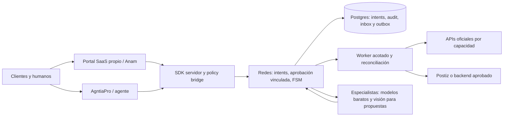

# Arquitectura y autoridad por dominio

Arquitectura propuesta, no desplegada. Node/TypeScript con Hono/pnpm reduce adaptación al repo padre; no se importa su servidor completo como librería ni se supone que todo middleware deba ser Python. Core puro de contratos/policy/FSM; persistencia transaccional; application services nominados; adaptadores de proveedor y de approval/budget/event bus; worker con leases/fencing; SDK servidor y vistas integrables. Runtimes de modelos quedan detrás de un puerto de propuesta sin credenciales sociales.

## Autoridades por encargo: solapamiento funcional permitido

La tabla siguiente es una coordinación recomendada cuando los servicios están conectados, no una prohibición de duplicar capacidades. Un cliente externo puede contratar redes sin los otros repos; redes aporta sus propios contratos, identidad, política, contenidos, presupuesto y atención. La autoridad se fija por ServiceAgreement/WorkOrder y campo/proyecto; ninguna ausencia de repo hermano obliga por sí sola a quedarse en demo.

| Dominio | Autoridad | Qué recibe redes |
|---|---|---|
| Identidad, membership, organización y SOPs | agente para sus clientes; IdP y runtime propios del SaaS para standalone/proveedor | Principales/bindings verificados por modo; nunca rol escrito por modelo |
| Marca y permisos editoriales | agntia-branding futuro | Snapshot de política/identidad de marca versionado, no prompt mutable |
| Objetivo, audiencia declarada y experimento | agntia-marketing futuro | Brief aprobado, límites y enlaces de medición; no targeting sensible inferido |
| Draft, variante, publicación y cuenta social | redes y proveedor según campo | Redes custodia intención/revisiones; proveedor confirma objeto/estado remoto |
| Contactos, consentimientos y soporte | agntia-clientes futuro | Referencias y handoff mínimo, con confirmación de identidad |
| Oportunidad y actividad comercial | agntia-ventas futuro | Señales aceptadas con permiso; un comentario no crea oportunidad automática |
| Caja, compromiso y presupuesto agregado | agntia-finanzas futuro | Reserva/receipt referenciados; no doble gastar wallets de distintos módulos |
| Tratamiento jurídico y derechos | agntia-legal futuro/humano | Dictamen o restricción referenciados; sin convertir clasificación LLM en permiso |
| Datos fiscales y expedientes | agntia-gestoria existente | Referencia cuando corresponde; no publicación de cifras fiscales por defecto |
| Incidentes y seguridad | agntia-ciberseguridad | Señales minimizadas y bloqueo técnico acordado, no nuevos privilegios |
| Coberturas/expedientes de seguro | agntia-seguros futuro | Solo casos derivados autorizados; no afirmaciones de cobertura generadas |
| Formación/evaluación de personas | agntia-formacion futuro | Material de entrenamiento anonimizado y consensuado; no volcar DMs privados |

## Persistencia propuesta

Tablas tenant-scoped accounts/connections/account_capabilities; briefs/brand_policy_snapshots; assets/asset_rights; drafts/variants/revisions; approval_bindings; publication_intents/attempts/remote_links/schedule_slots; inbox_events/message_threads/moderation_proposals; metric_observations/reports; budget_reservations; integration_inbox/outbox/receipts; audit_history. IDs externos se conservan como strings opacos, con provider+connection+account; no mapear por nombre ni NIF ni posición. Foreign keys compuestas por tenant y unicidades adecuadas a cada cardinalidad.

La mutación de estado, historial, idempotency record y outbox se confirma en una única transacción local. El HTTP remoto tiene su propia transacción y no puede formar parte atómica de Postgres. No se usa la expiración de un lock como prueba de que el proveedor no recibió una llamada. La cola no es el registro contable del efecto: el intent y sus receipts lo son.

Si se elige Postiz/Mixpost como backend de publicación, ese backend no custodia la aprobación empresarial final ni el presupuesto global. El adaptador limita sus endpoints/fields y mantiene bindings explícitos de workspace/cliente/cuenta. Su API admin o MCP amplio no se pasa al agente. Usar servicio dedicado por tenant al principio puede simplificar aislamiento, sin afirmar que sustituye pruebas cruzadas.

## Decisiones pendientes de la implementación

Fijar versiones/digests reales, DDL y migraciones; escoger almacenamiento y secreto manager según entorno; probar límites y recuperación; elegir autoridad de scheduling por proveedor; validar licencia por edición y forma de servicio. Un grafo de dependencias conceptual no acredita que los otros ocho repos estén implementados o disponibles. Si falta un servicio hermano, usar puertos locales completos y revisados de política/aprobación/presupuesto según el contrato standalone; bloquear solo si el control requerido no existe o no está verificado. No fabricar identidades, dictámenes o saldo por ese motivo.

CustomerWorkspace y providerOrganization están separados. La plataforma SaaS debe aislar clientes externos entre sí y de la propia empresa operadora; una tenantId del padre se mapea explícitamente al workspace del servicio, sin igualarlos por nombre. La sesión Anam conoce solo el workspace/proyecto autorizado y no obtiene permisos por ser un avatar. Ver [empresa SaaS](../07-empresa-saas-y-clientes-externos.md).
